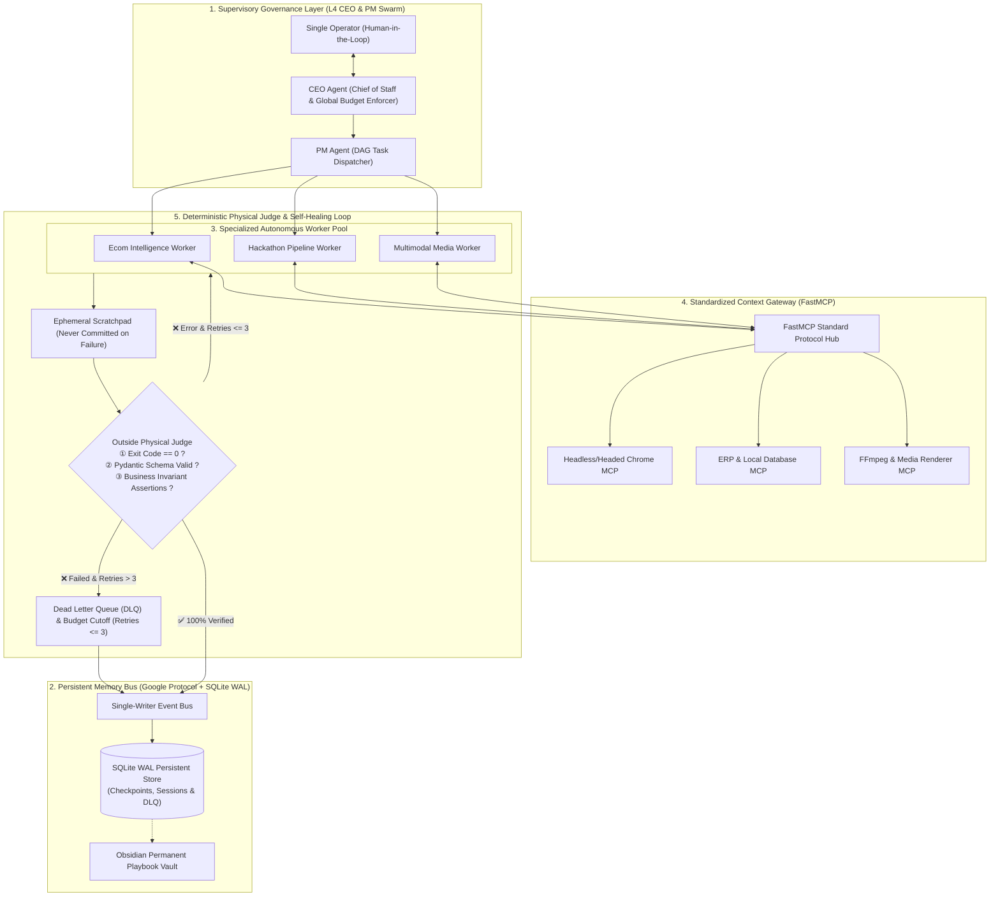

# 🚀 OmniNexus: Production-Ready Autonomous Multi-Agent Matrix

[](https://opensource.org/licenses/Apache-2.0)
[](https://www.python.org/)
[](https://deepmind.google/technologies/gemini/)
[](https://modelcontextprotocol.io/)
[](https://sqlite.org/)

> **OmniNexus** is an enterprise-grade, multi-agent operating matrix engineered for single-operator digital enterprises and cross-border commerce. Moving beyond fragile prompt-chain demos, OmniNexus features **deterministic circuit breakers**, **dual-state ephemeral scratchpads**, **three-tier persistent memory**, and **outside physical judge arbitration**.

---

## 🏗️ Architecture Topology

OmniNexus separates high-level supervisory governance from high-speed specialized task execution. Tasks flow along directed acyclic graphs (DAG) with strict physical gate assertions:



---

## 🛡️ Four Industrial Moats

### 1. Zero-Hallucination Grounding
Financial, inventory, and order facts are strictly grounded via native tool calls and Pydantic schema validation. Models are prohibited from guessing operational facts or prices.

### 2. Dual-State Isolation (Anti-Memory Poisoning)
Intermediate drafts and failed attempts during self-healing loops (`/loop`) are confined strictly to an in-memory **Ephemeral Scratchpad**. Only when an independent outside physical judge awards a 100% pass mark is the state atomically committed to SQLite, preventing cascading hallucinations.

### 3. Trust Ladder Progression (L2 to L4 Autonomy)
Sensitive operations begin under `HUMAN_APPROVAL`. After five consecutive unamended operator approvals, the action automatically elevates to `FULL_AUTO`. An outside judge error or operator rejection instantly triggers a safety-rail regression back to mandatory approval.

### 4. Dynamic Gated Stage-Gate Pipeline
- **Uphill Phase (Planning & Sourcing)**: Enforces adversarial red-teaming and web scraping reconnaissance to eliminate non-viable projects before committing compute.
- **Downhill Phase (Execution & Delivery)**: Disables external open-ended LLM debates, executing programmatic tasks under ruthless sub-second physical verification.

---

## ⚡ Quickstart: 10-Second Self-Healing Verification

Run the autonomous self-healing test directly:

```bash
# 1. Clone repository
git clone https://github.com/YasinGuo520/OmniNexus-Agent-Matrix.git
cd OmniNexus-Agent-Matrix

# 2. Install dependencies
pip install pydantic google-genai playwright aiohttp fastmcp

# 3. Run standalone self-healing and circuit breaker verification
python3 examples/quickstart_verification.py
```

Expected output:
```text
======================================================================
🚀 OMNINEXUS AI Autonomous Pipeline Verification
======================================================================
▶️ [Test 1]: Flakiness Self-Healing Loop (Recovers after 2 backoffs)
⚠️ [EcomWorker] Step 1 intercepted by Physical Judge: CAPTCHA detected, backing off 0.5s...
⚠️ [EcomWorker] Step 2 intercepted by Physical Judge: CAPTCHA detected, backing off 1.0s...
✅ Step 3 SUCCESS: Physical Judge awarded 100% pass (2 valid items extracted)

▶️ [Test 2]: Dead-Letter Queue (DLQ) Circuit Breaker
⚠️ Exceeded 3 max retries: Automatically intercepted and recorded into SQLite DLQ!
✅ Hard budget cutoff verified: Zero infinite token loops.
======================================================================
```

---

## 📁 Repository Structure

```text
OmniNexus-Agent-Matrix/
├── LICENSE                 # Apache-2.0 Open Source License (Copyright 2026 Yasin)
├── README.md                # System Architecture & Documentation
├── requirements.txt         # Core dependencies
├── core/
│   ├── base_worker.py       # BaseAutonomousWorker universal engine (/loop & dual-state)
│   ├── ceo_agent.py         # CEO Agent supervisor (WAL single-writer & trust ladder)
│   ├── inspector_agent.py   # Automated audit supervisor
│   └── mcp_hub.py           # Standardized FastMCP tool registry
├── workers/
│   ├── ecom_worker.py       # 8-step autonomous e-commerce pipeline
│   └── hackathon_worker.py  # Autonomous competition sourcing & submission assembler
├── database/
│   └── models.py            # SQLite WAL high-concurrency schema
└── examples/
    └── quickstart_verification.py  # Standalone self-healing test harness
```

---

## 📄 License & Attribution

This project is licensed under the **Apache License, Version 2.0**.  
See [`LICENSE`](LICENSE) for the full text.

**Copyright (c) 2026 Yasin.** All rights reserved.
